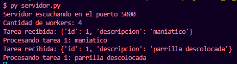
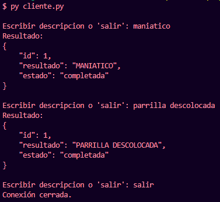

# Sistema Distribuido de Procesamiento de Tareas

## Descripción

Sistema distribuido desarrollado en Python que permite recibir tareas de clientes mediante sockets TCP y distribuirlas entre múltiples workers utilizando un pool de hilos.

El servidor acepta conexiones de clientes de forma concurrente, recibe tareas en formato JSON, las asigna a los workers disponibles y devuelve los resultados al cliente correspondiente.

## Tecnologías

- Python
- Socket (TCP)
- Threading
- Concurrent Futures (`ThreadPoolExecutor`)
- JSON

## Ejecución

1. Ejecutar el servidor:

   ```bash
   python servidor.py
   ```

2. Ejecutar el cliente:

   ```bash
   python cliente.py
   ```

## Funcionalidades

- Comunicación entre clientes y servidor mediante sockets TCP.
- Recepción y envío de tareas en formato JSON.
- Manejo concurrente de múltiples conexiones de clientes mediante threads.
- Distribución de tareas entre workers utilizando ThreadPoolExecutor.
- Procesamiento de tareas mediante un pool de hilos.
- Devolución de resultados al cliente correspondiente.
- Gestión del cierre de conexiones y errores de comunicación.

## Diagrama del sistema a finalizar y capturas de ejecución


---



---


